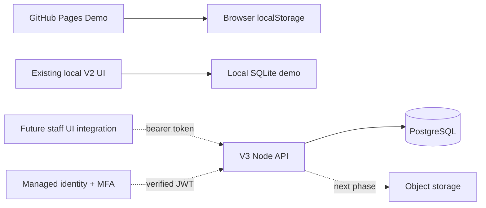

# V3 P0 foundation — implementation and staging plan

Baseline: V2 audit dated 2026-11-04, main `8975ea494eddd023e5fc19fce0c1eb8ee2faed68`.
This is the first P0 PR, not completion of all P0 acceptance criteria and not a production release.

## Architecture decision

Use a persistent Node service behind an HTTPS reverse proxy, a dedicated PostgreSQL database,
managed staff identity (Supabase Auth with asymmetric signing keys and MFA), and object storage.
Do not deploy the SQLite MVP to Vercel functions. PostgreSQL API code lives in `v3/src`;
`shared/catalog.js` is browser/Node compatible and starts the shared domain extraction.
V2 still owns the current UI. This PR intentionally does not claim full UI/data-layer unification.

## Implemented versus pending

Implemented: transactional, ordered/checksummed SQL migrations; database-backed staff roles;
JWT signature/issuer/audience/expiry validation; required MFA `aal2`; immediate staff disable;
catalogue create/list and draft filtering in public read API; transactional audit records;
media metadata schema; no default credentials or demo records; shared slug rule used by V2 and V3.

Pending P0: hosted database provisioning, real identity login/invitation/reset/MFA UI and flows,
staff UI integration, cloud object uploads, data transfer tooling, staging recovery rehearsal,
cross-device verification, browser E2E and security review. Password reset belongs to the
identity provider; this code does not implement or claim to test that provider's reset flow.

Pending P1: catalogue update/archive and pagination, variants, independent SKUs, inventory ledger,
many-to-many collections, image processing/picker, section editor and PostgreSQL page revisions.
The existing V2 editor and all original assets remain intact. P2 marketing work is deferred.
Cart, checkout, payment, membership, shipping and live revenue are NOT implemented. Unsupported
routes return 404/405 rather than successful mock transactions.

## Database schema

| Table | Key / relationships | Purpose |
|---|---|---|
| schema_migrations | name, checksum | Immutable migration history |
| staff | subject = verified provider subject; admin/editor/viewer | Staff allowlist, disable switch |
| collections | id; unique slug | Draft/active catalogue groups |
| products | id; unique handle; collection_id FK | Draft/active/archived product content |
| media | id; unique object_key; created_by FK | Pending/ready object metadata, MIME/size constraints |
| product_media | product_id/media_id FKs; ordered unique position | Ordered image associations |
| audit_events | actor FK; entity/id/action/timestamp | Mutation audit record |

Products currently have one explicit collection FK; a join table and migration belong to P1.
There is deliberately no order/payment table containing fabricated transactions.

## API contract

- `GET /health`: process health only; not database readiness.
- `GET /api/v3/storefront`: active products in active collections only; no drafts or staff data.
- `GET /api/v3/products`, `/collections`, `/media`: MFA staff; maximum 200 rows.
- `POST /api/v3/products`, `/collections`: MFA Admin/Editor; JSON; writes and audit in one transaction.
- Viewer cannot write. No API exists to self-promote roles or create staff.
- Media upload is not exposed until object verification/authorization is implemented.

Only Authorization bearer tokens are accepted: no cookie session and no permissive CORS.
This avoids cookie-driven CSRF in this foundation. The future browser adapter must keep access
tokens in memory, implement provider refresh/logout correctly, and never persist service keys.
Short token lifetimes are required; provider password reset alone cannot invalidate already-issued
JWTs instantly. Disable `staff.active` during an incident and revoke provider sessions as well.

## Environment configuration

Copy `v3/.env.example` into a private local configuration; do not commit it. Node does not load
the file automatically: use the hosting secret manager or `node --env-file=.env src/server.mjs`.

- `DATABASE_URL`: restricted API PostgreSQL account, TLS with certificate verification.
- `MIGRATION_DATABASE_URL`: separate schema-owner account used only during release migrations.
- `AUTH_ISSUER`: exact Supabase project Auth issuer URL.
- `AUTH_AUDIENCE`: expected audience, normally `authenticated`.
- `AUTH_JWKS_URL`: that project's HTTPS JWKS endpoint; never derive it from an incoming JWT.
- `HOST`, `PORT`: default loopback/3100; bind privately behind the HTTPS gateway.
- `TEST_DATABASE_URL`: disposable database only; optional locally, required in CI.

No service-role key, admin password or payment secret is needed for these offline tests.
Object storage configuration will be specified when the storage adapter is implemented; no
unused secret placeholders imply an integration exists.

## Staging deployment procedure (not yet exercised on hosted infrastructure)

1. Provision separate preview/staging/production databases and identity projects. Use a dedicated
   database not shared with other applications. Keep tables out of exposed PostgREST schemas.
2. Require TLS, private networking where available, automated backups and point-in-time recovery.
   Use encrypted backup storage, restricted access and documented retention; agree RPO/RTO with owner.
3. `cd v3 && npm ci`; supply the migration URL and run `npm run migrate`. Migrations run in one
   transaction with an advisory lock and reject checksum changes. Never edit an applied migration.
4. Provision a separate non-owner runtime database role. Grant schema usage and SELECT on staff;
   SELECT/INSERT on products and collections; SELECT on media; INSERT on audit_events; required
   identity-sequence USAGE. Do not grant staff/audit UPDATE/DELETE, DDL or superuser. Manage grants
   in the infrastructure release process with actual role names. The owner credential is not runtime.
5. Invite staff through the provider console; complete MFA and recovery setup. Insert verified
   subjects and least-privilege roles into staff through an authorized administrative session.
   Disable public sign-up for staff. Do not use editable user metadata to assign roles.
6. Configure API secrets and HTTPS gateway, request/rate limits, body/time limits and access logs
   with Authorization/body redaction. Run `npm start` on the persistent service. No backend
   deployment is performed by GitHub Pages or this PR.
7. Verify two distinct staff accounts, viewer rejection, disabled user, expired token, MFA and
   password reset, restart persistence, draft exclusion and storage behavior before UI cutover.
8. Deploy a preview of the shared UI adapter only after those checks. Keep GitHub Pages Demo.

## Migration and recovery safeguards

V2 SQLite/uploads are not read or modified by this PR. Before import, snapshot SQLite and uploads;
prepare explicit source-id mapping, catalogue counts, SKU conflicts, image checksums and page
revision mapping in a dry run. Do not automatically import sample orders/customers as live data.
The importer and reconciliation UI are future work, not implemented here.

On migration failure the transaction rolls back. On app regression deploy the previous application
version while retaining additive schema. Do not DROP production tables to roll back. For data loss,
restore a point-in-time backup into a NEW isolated database, reconcile counts/asset keys and replay
validation before changing the service connection. Rehearse this in staging and record timings and
evidence; no recovery guarantee is asserted until that rehearsal passes.

Monitor failed authentication, denied writes, error rates, database pool exhaustion, backup failures
and storage orphans. Incident response: restrict ingress, disable affected staff, revoke sessions,
rotate compromised server secrets, preserve audit evidence and restore only after verification.

## Tests and limits

`cd jackstudio-admin-mvp && npm test` preserves V2 regressions.
`cd v3 && npm ci && npm test` runs PostgreSQL-WASM constraint/transaction tests and signed-JWT/API
tests. The real PostgreSQL test is skipped locally without TEST_DATABASE_URL; CI supplies PostgreSQL
17 and tests the actual migration advisory lock and persistence across database connections.
No cloud MFA/reset, browser E2E, hosted restore or production penetration test is implied.

Identity reference: https://supabase.com/docs/guides/auth/jwts
MFA reference: https://supabase.com/docs/guides/auth/auth-mfa
